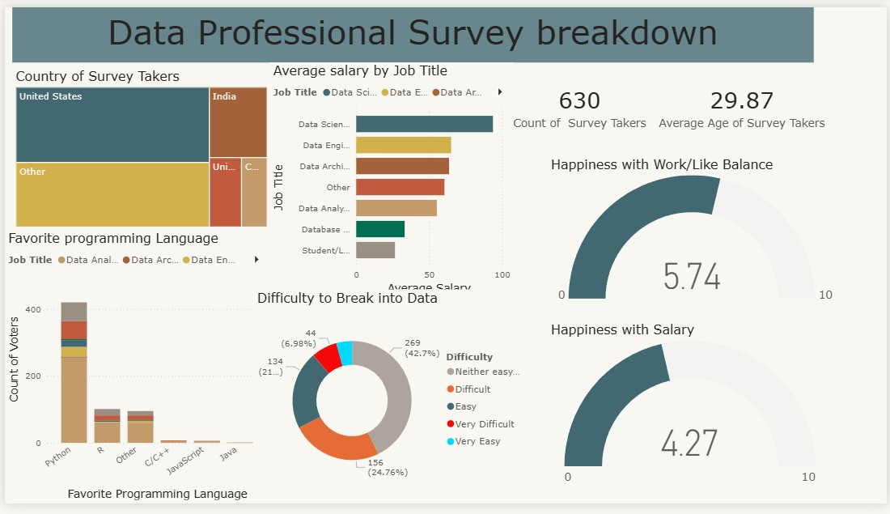

# Data Professional Survey – Power BI Dashboard

An interactive Power BI dashboard that analyzes a survey of 630 data professionals.

## Objective
To understand who works in data, what they earn, which programming languages they
prefer, how satisfied they are, and how hard it is to break into the field.

## Dataset
- Data Professional Survey (Excel), 630 responses, 28 columns
- Includes job title, salary range, industry, favorite language, satisfaction
  ratings, age, country and education

## Tools Used
- Power BI (data modeling, DAX column, visuals)
- Microsoft Excel (source data)

## Dashboard Includes
- Country of survey takers (treemap)
- Average salary by job title (bar chart)
- Favorite programming language (column chart)
- Difficulty to break into data (donut chart)
- Happiness with salary and work/life balance (gauges)
- Survey takers count and average age (cards)

## Key Insights
- Python is the favorite language (420 of 630 respondents).
- Data Analyst is the most common job title (381 respondents).
- Most respondents are from the US (261), followed by India (73).
- About 32% found it difficult or very difficult to break into data.
- Happiness with salary (4.27/10) is lower than with work/life balance (5.74/10).
- Data Scientists have the highest average salary among the job titles.

## Files
- `data-professional-survey-powerbi-dashboard.pbix` – Power BI file
- `data-professional-survey-dataset.xlsx` – dataset
- `dashboard.png` – dashboard screenshot

## Author
**Sikandar Khan**
[LinkedIn](https://www.linkedin.com/in/sikandar-khan-5ba465422/) | [GitHub](https://github.com/sikandar-data-analyst)
